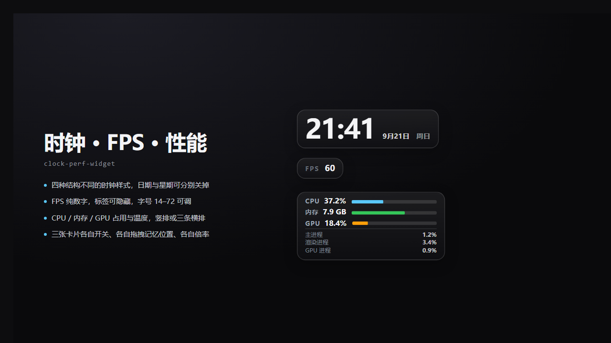

# 时钟 · FPS · 性能悬浮卡（clock-perf-widget v2.2.0）



给 Folia 0.7.x（Folium 1.x）的三个**互相独立**的悬浮卡：时钟、FPS、性能监测。
三者各有独立的显示开关、位置（各自拖拽、各自记忆）、样式与大小，各自注册到两个舞台层
（`app.overlay` 与 `player.stage.front`），由 `placement` 决定哪一层生效。

纯 ESM `client.mjs` + CJS `main.cjs`，零依赖、零构建。

## 组件

| 组件 | 内容 | 默认角 | 尺寸（scale=1） |
| --- | --- | --- | --- |
| 时钟 | 时分（四种**结构不同**的样式，见下）+ 可选日期 / 星期，无进度条 | 左上（离左边再多让 96px，避开窗口左上角的返回/菜单按钮） | 自适应 |
| FPS | 纯数字（`FPS` 标签在数字左侧基线对齐），**没有条** | 左下 | 自适应 |
| 性能 | CPU 合计 / 内存工作集 / GPU 占用 / GPU 温度 + 分进程明细（折叠） | 右下 | 固定宽 |

关闭开关（`clockShow` / `fpsShow` / `perfShow`）后该组件的**两层都不渲染**，定时器与 rAF 一并停掉。

## 文件

| 文件 | 作用 |
| --- | --- |
| `client.mjs` | 渲染进程入口：注册设置面板 + 6 个舞台层，建卡、拖动、样式、轮询 |
| `main.cjs` | 主进程入口：`api.rpc.handle('metrics')` 采集 CPU / 内存 / GPU |
| `mod.json` | 清单：`ui.stage` + `filesystem.data`（后者解锁 `folium.storage`） |
| `selfcheck.mjs` | 零依赖自检：DOM / timer / rAF / folium 全套 stub，155 条断言 |
| `preview.html` | 静态样式预览页：单文件、零依赖，浏览器直接打开对比四种时钟样式与两种性能布局 |

自检：`node selfcheck.mjs`（非零退出即失败）。预览：双击 `preview.html`（无需起服务、无需宿主）。

## 设置

### 通用

| key | 类型 | 默认 | 范围 / 选项 | 说明 |
| --- | --- | --- | --- | --- |
| `placement` | select | `global` | `global` / `player` / `off` | 哪一层生效：全局顶层 / 仅播放页 / 都不显示 |
| `refreshNow` | boolean | `false` | — | 一次性立即刷新：置 true 后组件立刻重跑一遍应用逻辑，随即自动重置为 false |

### 时钟

| key | 类型 | 默认 | 范围 / 选项 | 说明 |
| --- | --- | --- | --- | --- |
| `clockShow` | boolean | `true` | — | 显示时钟 |
| `clockStyle` | select | `minimal` | `minimal` / `terminal` / `stacked` / `outline` | 四种**排版结构不同**的样式，见下 |
| `clockShowDate` | boolean | `true` | — | 显示日期（四种样式都生效） |
| `clockShowWeekday` | boolean | `true` | — | 显示星期（四种样式都生效） |
| `clock24` | boolean | `true` | — | 24 小时制（四种样式都生效） |
| `clockColor` | color | `#f4f4f6` | `#rrggbb` | 文字色 |
| `cornerClock` | select | `top-left` | 四个角 | 双击回位的角落；改设置立即贴过去，不受历史拖动位置影响 |
| `clockClickThrough` | boolean | `false` | — | 打开后卡片 `pointer-events: none`，不挡下面的按钮；同时不能拖动 |

### 四种时钟样式

| 样式 | 结构 |
| --- | --- |
| `minimal` | 单行超大细字 `3.2em` / 字重 600 / 字距 `-0.02em`；日期与星期以 `0.8em` 小字贴在时间**右侧、基线对齐**（`gap: 10px`）；无 prompt |
| `terminal` | 整卡等宽字体。首行 `>_` + ISO 日期（`0.72em` / 字距 `0.08em`）+ 星期；次行 24 小时制 `2.6em` / 字重 600 / 字距 `0.06em`，末尾一个 `▌` 方块光标，每 500ms 与冒号同步闪烁 |
| `stacked` | 日期与星期作为右上角的**表头**（`0.8em` / 字重 700 / 字距 `0.16em`，星期 `opacity: 0.55`），下面小时与分钟**上下两行** `3em` / 字重 800 / 右对齐，两行之间一条 `2.6em` 宽细线（`opacity: 0.45`），三者的右边缘对齐 |
| `outline` | `3.4em` / 字重 800 + `-webkit-text-stroke: 1px currentColor`，无发光；日期与星期在数字下方居中、`0.7em` 字号 / 字距 `0.3em`；**忽略卡片底色**（始终透明，`cardBackground` 对它不生效） |

所有数字使用 `font-variant-numeric: tabular-nums`，跳秒不抖宽度；数字字重一律不低于 600。
旧存档里的 `mono` / `glow` / `neon` 会分别落到 `terminal` / `outline` / `outline`。

### FPS

| key | 类型 | 默认 | 范围 / 选项 | 说明 |
| --- | --- | --- | --- | --- |
| `fpsShow` | boolean | `true` | — | 显示 FPS |
| `fpsShowLabel` | boolean | `true` | — | 数字**左侧**显示 `FPS` 标签（`0.72em` / 字距 `0.18em` / `opacity: 0.6`） |
| `fpsFontSize` | number | `26` | 14–72，step 1 | 数字字号（会再乘 `scale`；字重固定 700） |
| `fpsValueColor` | select | `#f4f4f6` | 调色板 | 数字颜色 |
| `fpsLabelColor` | select | `#9aa4b2` | 调色板 | `FPS` 标签颜色 |
| `cornerFps` | select | `bottom-left` | 四个角 | 双击回位的角落；改设置立即贴过去，不受历史拖动位置影响 |
| `fpsClickThrough` | boolean | `false` | — | 打开后卡片 `pointer-events: none`，不挡下面的按钮；同时不能拖动 |

### 性能监测

| key | 类型 | 默认 | 范围 / 选项 | 说明 |
| --- | --- | --- | --- | --- |
| `perfShow` | boolean | `true` | — | 显示性能卡 |
| `showCpu` | boolean | `true` | — | CPU 合计行 |
| `showMemory` | boolean | `true` | — | 内存工作集行 |
| `showGpu` | boolean | `true` | — | GPU 占用 + 温度行 |
| `showDetails` | boolean | `false` | — | 展开分进程明细（main / renderer / gpu） |
| `barLayout` | select | `vertical` | `vertical` / `horizontal` | `vertical`：条目竖排、条在数值右侧；`horizontal`：CPU / 内存 / GPU **三条横着并排**，每条的标签与数值占一行，短条（`3px`，最长 `72px`）贴在条目下方 |
| `colorCpu` | select | `#5ac8fa` | 调色板 | CPU 条颜色 |
| `colorMemory` | select | `#34c759` | 调色板 | 内存条颜色 |
| `colorGpu` | select | `#ff9f0a` | 调色板 | GPU 条颜色 |
| `perfLabelColor` | select | `#9aa4b2` | 调色板 | 标签颜色（CPU / 内存 / GPU 与分进程明细） |
| `perfValueColor` | select | `#f4f4f6` | 调色板 | 数值颜色 |
| `memoryLimitGb` | number | `4` | 1–64，step 1 | 内存条满格对应的 GB 数 |
| `refreshMs` | select | `1000` | `500` / `1000` / `2000` | 指标轮询间隔 |
| `cornerPerf` | select | `bottom-right` | 四个角 | 默认右下角，避开窗口右上角的控制按钮；改设置立即贴过去 |
| `perfClickThrough` | boolean | `false` | — | 打开后卡片 `pointer-events: none`，不挡下面的按钮；同时不能拖动 |

条的长度归一：CPU、GPU 按 0–100；内存按 `memoryLimitGb`。三者都 clamp 到 0–1。

颜色项都是**预设下拉**（宿主只渲染开关 / 下拉 / 滑条，`type: 'color'` 不会出现在面板里）。调色板：白 `#f4f4f6`、银灰 `#9aa4b2`、天蓝 `#5ac8fa`、青 `#64d2ff`、葱绿 `#39c5bb`、薄荷绿 `#34c759`、柠檬黄 `#ffd60a`、琥珀 `#ff9f0a`、珊瑚红 `#ff375f`、紫 `#bf5af2`。

两种布局下分进程明细（主进程 / 渲染进程 / GPU 进程）都固定竖排在最下方。

### 外观与大小（三个组件共用）

| key | 类型 | 默认 | 范围 / 选项 | 说明 |
| --- | --- | --- | --- | --- |
| `cardBackground` | boolean | `true` | — | 关闭即纯文字：不留底色、不留 `backdrop-filter`（`outline` 时钟无论此项如何都保持透明） |
| `cardOpacity` | number | `0.55` | 0–1，step 0.05 | 卡片底色不透明度 |
| `backdropOpacity` | number | `0.55` | 0–1，step 0.05 | 毛玻璃强度：同时缩放 `backdrop-filter` 的 blur 半径与底色上的高光 |
| `scale` | number | `1` | 0.7–1.6，step 0.05 | 整卡倍率（宽 / padding / 圆角 / 字号统一乘倍率，不用 `transform: scale()`） |

`scale` 走的是尺寸与字号实算，不是 `transform: scale()`：后者会把文字栅格化后放大（发虚），
并且缩放后的命中区域仍按未缩放盒模型算，拖动会错位。

## 样式预览页

`preview.html` 是单文件零依赖的静态预览：深色背景（`#0d0d0f`）上并排展示四种时钟样式、
FPS 卡（含隐藏标签后的收窄效果）、性能卡的 `vertical` 与 `horizontal` 两种布局。
其中的字号、字重、字距、`gap`、条宽与颜色全部抄自 `client.mjs` 的 `CLOCK_LOOKS` /
`CARD_SHELL_CSS` / `makeMetricRow` 与 `applyScale`（`scale = 1`），用于挑设计，不参与运行时。

改样式时请同步改 `preview.html`，否则预览会与实际渲染脱节。唯一有意的差异：预览里的卡片是
`position: relative`（真实挂件是 `position: fixed` + JS 定位）。

## GPU 数据源与降级

`main.cjs` 的 `metrics` 返回：

```js
{
  totalCpu, totalMemKb,
  gpu: { utilPct, tempC, memUsedMb, memTotalMb, powerW, source },
  byType: { main, renderer, gpu }
}
```

`gpu.source` 有两档：

1. `nvidia-smi`（首选）—— `execFile` 调
   `--query-gpu=name,utilization.gpu,temperature.gpu,memory.used,memory.total,power.draw --format=csv,noheader,nounits`，
   `windowsHide: true`，超时 3s。结果在主进程缓存 2s，避免每次 rpc 都 spawn（单次 50–200ms）。
   本机实测输出：`NVIDIA GeForce RTX 5070, 14, 45, 5931, 12227, 45.26`。
2. `electron`（降级）—— 用 `app.getAppMetrics()` 里 GPU 进程的 `cpu.percentCPUUsage` 当占用率，
   `tempC` 为 `null`，前端显示 `—`；显存与功耗同样为空。

降级是**粘性**的：`nvidia-smi` 失败一次（不存在、超时、解析失败）就打上标记不再重试，
也不再重复写日志——避免每 1–2 秒往日志里刷同一条错误。`gpu.source` 由主进程决定，
渲染进程只按它决定显示温度还是 `—`。

## 为什么设置改动靠 1 秒轮询

`ctx.onChange` 在 Folia 0.7.20 上**改设置时不会触发**（用户实测：改完不刷新）。
设置句柄是 `section.params`（老版本 `section.settings`），且**没有 `onChange` 方法**。
所以 v2 的做法是：

- 每 1000ms 读一次 `settings.get()`，与上一次的序列化结果比较，不同就重跑一遍应用逻辑；
- 另给一个 `refreshNow` 布尔设置做「立刻刷新」的手动补丁；
- `ctx.onChange` 仍然注册（`typeof` 保护），将来宿主修好了能立刻生效，不冲突。

代价是最多 1s 的延迟；轮询本身只做一次读 + 字符串比较，成本可忽略。

## 实现约束

- **DOM 只建一次**：刷新只写 `textContent` / `style` / `transform`，不重建节点。
- **拖动**：`pointerdown` + `setPointerCapture` + `pointermove`，位置按视口比例存
  `folium.storage`（`pos-clock` / `pos-fps` / `pos-perf`），`resize` 后按比例重算并 clamp，
  双击回各自默认角。
- **角落设置优先**：每次应用设置都拿当前 `cornerXxx` 与上次应用的角落比对——变了就
  `applyCorner(新值)` 并把比例写回 `storage`（手动拖过也照样跳过去），没变才按存下来的比例复原；
  `scale` 变化时同样按当前角落重新贴边。首屏不写 `storage`，避免覆盖上一次的位置存档。
- **鼠标穿透**：`pointer-events` 不在卡片常量里写死，由 `clockClickThrough` / `fpsClickThrough` /
  `perfClickThrough` 在运行时把卡片覆写成 `none` 或 `auto`；穿透时拖动与双击整体短路。舞台层保持宿主默认的点击穿透。
- **定时器**：统一由 `syncLoops()` 管，组件不可见或被关掉时不跑 rAF / interval。
- **宿主 API 一律 `typeof` 保护**：`settings.get/set/onChange`、`ctx.every/onChange/getTheme`、
  `folium.rpc.call`、`folium.storage.*`，任何一个缺失都只是少一个能力，不抛异常。

## 安装

1. 下载本仓库（git clone 或 Release 里的源码包），把整个目录放到 Folia 的用户模组目录：
   `%APPDATA%\Folia\mods\clock-perf-widget`（即 `userData/mods/<模组 id>`）。
2. 打开「设置 → 模组 → 模组系统」总开关，再在模组面板里确认启用本模组（会弹出原生确认窗口，
   列出权限与内容摘要）。
3. 启用后三张卡默认出现在左上、左下、右下；拖动即记位置，双击回默认角。

也可以在模组面板里把目录打成 zip 直接拖进去安装。权限只有 `ui.stage`（往舞台层画东西）与
`filesystem.data`（记住拖拽位置与设置）。

## 许可证

MIT，见 [LICENSE](LICENSE)。

## 排查提示

- 舞台层挂在 shadow root 里，`document.querySelector` 查不到卡片；先取 `[data-folium-entry]` 的 `shadowRoot`。
- 宿主把 mount 异常写进日志：`[Folium:<modId>] stage layer <entry> mount: <error>`；异常发生在
  `container.appendChild(card)` 之后时，卡片会残留 DOM 但停在初始样式——看到「有卡但不更新」优先查这里。
